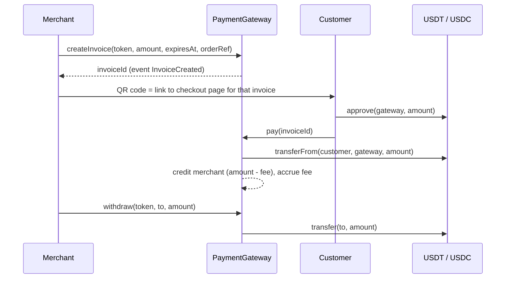

<p align="center">
  
</p>

# USDT / USDC Payment Gateway

[](https://github.com/charlie-hk/usdt-usdc-payment-gateway/actions/workflows/ci.yml)
[](LICENSE)

An invoice-based stablecoin payment gateway for Ethereum, built for the Sepolia testnet.

- **Smart contract** (`PaymentGateway.sol`): merchants create invoices in USDT or USDC, customers pay them, the contract holds the funds, merchants withdraw.
- **QR checkout**: every invoice gets a QR code that opens a checkout page where the customer pays from their own wallet (browser extension or WalletConnect).
- **Merchant dashboard**: live list of invoices (pending, paid, cancelled, expired), per-token totals and fees, withdraw and cancel buttons.

> **Testnet only. This code has not been audited.** Do not deploy it to mainnet or send it real funds.

**Live demo (Sepolia testnet):** https://charlie-hk.github.io/usdt-usdc-payment-gateway/

> **Wallet warning: please read.** When you connect MetaMask to the demo, it currently shows its security alert "Malicious—flagged as unsafe" ("This site shows signs of phishing or wallet-draining activity"). The author believes this is a false positive and asked the provider behind these alerts (Blockaid, named in [MetaMask's documentation](https://support.metamask.io/configure/wallet/security-alerts/)) to review it on 2026-10-19; no answer yet. What is known: `charlie-hk.github.io` was not in MetaMask's public phishing blocklist when checked on 2026-10-19, the demo is a new site on the shared `github.io` domain, and the reason for the alert is not known. The site is built by [a public workflow](.github/workflows/pages.yml) from the code in this repository, and the contract is [verified on Etherscan](https://sepolia.etherscan.io/address/0x339A644b27bf8A034dE32DCB814426f5CcB4c97B#code). If you try it, use a throwaway account that holds only Sepolia test tokens, never a wallet with real funds, and compare the contract address in every confirmation with the one above. You can also skip the live site and run everything locally (see Quick start).

## Screenshots

Taken from a local run (Hardhat network, test tokens).

| Merchant creates an invoice | Customer checkout |
| --- | --- |
|  |  |

| Dashboard after a payment | Checkout on a phone |
| --- | --- |
|  |  |

## How it works



The QR code encodes a **link** to the checkout page, not a raw ERC-20 transfer (EIP-681). A plain transfer would move tokens without telling the contract which invoice it settles, so the contract could never mark it as paid.

### Design decisions

| Decision | Why |
| --- | --- |
| Pull-payment accounting (`withdraw`) | A payment never sends tokens to the merchant, so a reverting or blocklisted merchant address cannot block a customer. Withdrawals keep working while the contract is paused. |
| `SafeERC20` everywhere | Mainnet USDT does not return a value from `transfer`, `transferFrom` or `approve`. A plain `IERC20` call would revert on it. |
| Balance check after `transferFrom` | The amount received must equal the invoice amount, otherwise the payment reverts. This rejects fee-on-transfer tokens (mainnet USDT has a dormant fee switch). |
| Exact-amount approvals in the UI | The checkout approves the invoice amount, never an unlimited allowance. For USDT-style tokens it resets a stale non-zero allowance to 0 first, because USDT's `approve` reverts otherwise. |
| `payWithPermit` (EIP-2612) | One-transaction payment for USDC. The permit call is wrapped in `try/catch`, so a front-run permit cannot make the payment fail. |
| `totalHeld` accounting + `sweepUnaccounted` | Tokens sent to the contract by mistake can be recovered, and the function can never touch merchant balances or accrued fees. |
| Fee fixed at payment time, capped at 5% | A later fee change never alters what a merchant already earned. |
| Two-step ownership, `renounceOwnership` disabled | Avoids handing admin rights to a wrong address or stranding accrued fees. |

### Contract reference

| Function | Who | What it does |
| --- | --- | --- |
| `createInvoice(token, amount, expiresAt, orderRef)` | anyone (becomes the merchant) | Creates an invoice. `expiresAt = 0` means no expiry. Returns a sequential id. |
| `pay(invoiceId)` | customer | Pays after `approve`. Reverts if the invoice is not pending, expired, or the token is delisted. |
| `payWithPermit(invoiceId, deadline, v, r, s)` | customer | Same, with an EIP-2612 permit instead of a separate `approve`. |
| `cancelInvoice(invoiceId)` | merchant | Cancels a pending invoice. |
| `withdraw(token, to, amount)` | merchant | Withdraws part of the merchant's balance to any address. |
| `getInvoice`, `isPayable`, `quoteFee`, `merchantBalance`, `feeBalance` | view | Reads. |
| `setSupportedToken`, `setFeeBps`, `pause`, `unpause` | owner | Configuration. |
| `withdrawFees`, `sweepUnaccounted` | owner | Collect accrued fees; recover tokens sent by mistake. |

## What has and has not been verified

Verified by running it:

- **48 contract tests** pass (`npx hardhat test`, local Hardhat network). `npx hardhat coverage` reports 100% statements, lines and functions and 91.46% branches for `PaymentGateway.sol` (same 48 tests). The test-only token mocks in `contracts/mocks/` are excluded from the report (see `.solcover.js`); they are not production code.
- **12 end-to-end checks** (`npm run frontend:e2e`) run the frontend's own contract layer (`frontend/src/lib`) against a local Hardhat node: create invoice, pay with USDT (including the allowance reset), pay with USDC, expiry, cancel, dashboard rows and fee, withdraw.
- **Sepolia deployment**: `PaymentGateway` (block 11947117) and `MockUSDT` are deployed on Sepolia and their source is verified on Etherscan ("Exact Match", Solidity 0.8.24, optimizer 200 runs). Links in the table below. The gateway is wired to Circle's Sepolia USDC and `MockUSDT`, fee 50 bps.
- **Real wallet on the live demo**: MetaMask connected to the hosted site on Sepolia and created an invoice (the first attempt failed on-chain and the second succeeded; the cause was not confirmed). Scanning the invoice QR with a phone opened the hosted checkout page. One run, one person, one device.
- **Browser run**: headless Chromium (Playwright) with a mock wallet that signs through a local node drove the full UI: connect, create invoice and QR, customer checkout with faucet and payment, dashboard update, withdraw, cancel, QR dialog, cancelled / unknown / malformed invoice links, phone-width layout. No console errors.

**Not** verified:

- Paying an invoice and withdrawing on Sepolia with a real wallet. Only invoice creation was done there. WalletConnect pairing (needs a project ID) and wallets other than MetaMask were not tried either.
- `payWithPermit` is tested at contract level against a mock; the UI uses `approve` + `pay`.
- No static analysis tool (Slither or similar) has been run. No audit.

### Live deployment

| Item | Address |
| --- | --- |
| PaymentGateway (Sepolia) | [`0x339A644b27bf8A034dE32DCB814426f5CcB4c97B`](https://sepolia.etherscan.io/address/0x339A644b27bf8A034dE32DCB814426f5CcB4c97B#code) |
| USDC | Circle's Sepolia USDC (see below) |
| Mock USDT | [`0x26c8D3B7E403FA20955aB7Fe50fE6881eC99f47F`](https://sepolia.etherscan.io/address/0x26c8D3B7E403FA20955aB7Fe50fE6881eC99f47F#code) |

## Tokens on Sepolia

- **USDC**: the deploy script defaults to Circle's Ethereum Sepolia USDC, `0x1c7D4B196Cb0C7B01d743Fbc6116a902379C7238`, taken from [Circle's contract address list](https://developers.circle.com/stablecoins/usdc-contract-addresses). Set `USE_MOCK_USDC=true` to deploy `MockUSDC` instead.
- **USDT**: no official Tether deployment on Sepolia was found while building this (one web search, no primary source), so the script deploys `MockUSDT`. It reproduces the two USDT behaviours that break naive integrations: no return values and the "reset allowance to 0 first" rule. To use an existing token instead, set `USDT_ADDRESS`.
- The mock tokens have an open `faucet(amount)` (max 10,000 per call), and the checkout page offers a "Get test tokens" button for them.

## Quick start

Requires Node.js 20 or newer.

```bash
npm ci
npm test                 # 48 contract tests
npm run coverage         # coverage report in ./coverage
npm run demo             # create, pay and withdraw one invoice, printed to the console
```

If your network blocks `binaries.soliditylang.org` (Hardhat cannot download the compiler), compile with the `solc` npm package instead:

```bash
USE_SOLCJS=true npm test
```

### Run the whole stack locally

```bash
npx hardhat node                      # terminal 1: local chain on http://127.0.0.1:8545
npm run deploy:local                  # terminal 2: deploys mocks + gateway, writes frontend/public/deployment.json
npm --prefix frontend ci
npm run frontend:dev                  # terminal 3: open the URL that Vite prints
```

In MetaMask, add a network with RPC `http://127.0.0.1:8545` and chain ID `31337`, then import one of the test accounts printed by `hardhat node`. Use one account as the merchant and another in a second browser profile as the customer.

To run the contract-layer end-to-end script against that chain: `npm run frontend:e2e` (needs a fresh chain, because it asserts exact invoice lists).

## Deploy to Sepolia

1. Copy `.env.example` to `.env` and fill in `SEPOLIA_RPC_URL`, `DEPLOYER_PRIVATE_KEY` (a throwaway wallet with Sepolia ETH, never one that holds real funds) and `ETHERSCAN_API_KEY`.
2. Deploy:

   ```bash
   npm run deploy:sepolia
   ```

   This deploys `MockUSDT` and the gateway and writes `deployments/sepolia.json` and `frontend/public/deployment.json` (the file the frontend reads at runtime). When `ETHERSCAN_API_KEY` is set it then waits for 5 confirmations and verifies the contracts on Etherscan; if verification fails, repeat it with `npm run verify:sepolia`.
3. Optional settings in `.env`: `OWNER_ADDRESS`, `FEE_BPS` (default 50 = 0.50%, max 500), `USDC_ADDRESS`, `USDT_ADDRESS`, `USE_MOCK_USDC`.
4. Put the addresses from `deployments/sepolia.json` into the deployment table above.

### Frontend

```bash
cp frontend/.env.example frontend/.env     # optional: WalletConnect project ID, RPC URL
npm run frontend:build                     # static site in frontend/dist
```

The build uses relative paths and hash routing (`#/pay/12`), so it works on any static host, including GitHub Pages project sites. `deployment.json` is fetched at runtime, so it can be replaced without rebuilding.

| Variable | Purpose |
| --- | --- |
| `VITE_WALLETCONNECT_PROJECT_ID` | Enables the WalletConnect button. Create a project ID in the Reown (formerly WalletConnect) dashboard. Without it only browser-extension wallets can connect. |
| `VITE_SEPOLIA_RPC_URL` | Read-only RPC for the checkout page and the dashboard's event scan. Defaults to viem's public Sepolia endpoint, which is rate-limited. |

## Limitations and trust assumptions

- **Owner powers**: the owner can pause invoice creation and payment, change the fee (max 5%, applies to future payments only) and delist a token (open invoices in it can no longer be paid). The owner cannot reach merchant balances: `withdrawFees` is capped at accrued fees and `sweepUnaccounted` only moves tokens that no invoice accounts for. Withdrawals are never paused.
- **Token issuer risk**: USDC and USDT issuers can blocklist addresses. If the gateway contract itself were blocklisted, every balance in it would be frozen. Pull-payment accounting limits the damage of a blocklisted merchant to that merchant.
- **Anyone can be a merchant**: there is no allowlist. The checkout page shows the merchant address and amount; a customer should confirm them before paying.
- **Exact amounts only**: no partial payments, overpayments or refunds in this version.
- **Expiry** uses `block.timestamp`, so it is accurate to a block, not to the second.
- **Dashboard history** is read from event logs starting at the deployment block, in windows sized near the free RPC's own range cap and backed off between retries, so a cold load doesn't burn repeated failed requests. If the RPC still fails, the on-page error message now includes its HTTP status. Free RPC plans can still be slow on long histories.
- **Order labels** typed by the merchant are stored on-chain only as a hash; the readable text lives in the merchant's browser (`localStorage`).
- Rebasing and fee-on-transfer tokens are not supported.

## Project structure

```
contracts/
  PaymentGateway.sol        the gateway
  mocks/                    MockUSDC (EIP-2612), MockUSDT (USDT quirks), MockFeeToken (test only)
test/PaymentGateway.test.js 48 tests
scripts/
  deploy.js                 deploy + record + Etherscan verification
  verify.js                 re-run verification from deployments/<network>.json
  demo-local.js             console walkthrough
  export-abi.js             copies the compiled ABI into the frontend
frontend/
  src/lib/gateway.ts        contract calls, event scan, error messages (no DOM, reused by the e2e script)
  src/views/                merchant console + dashboard, customer checkout
  e2e/local-e2e.ts          contract-layer end-to-end script
  public/deployment.json    addresses the frontend reads at runtime
deployments/                deployment records
docs/                       cover image and screenshots
```

## License

[MIT](LICENSE) © Ali Amini
